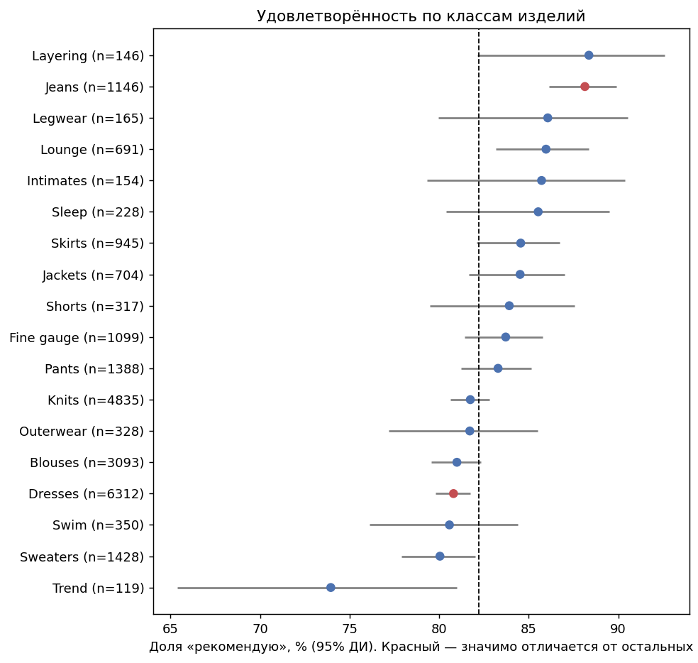
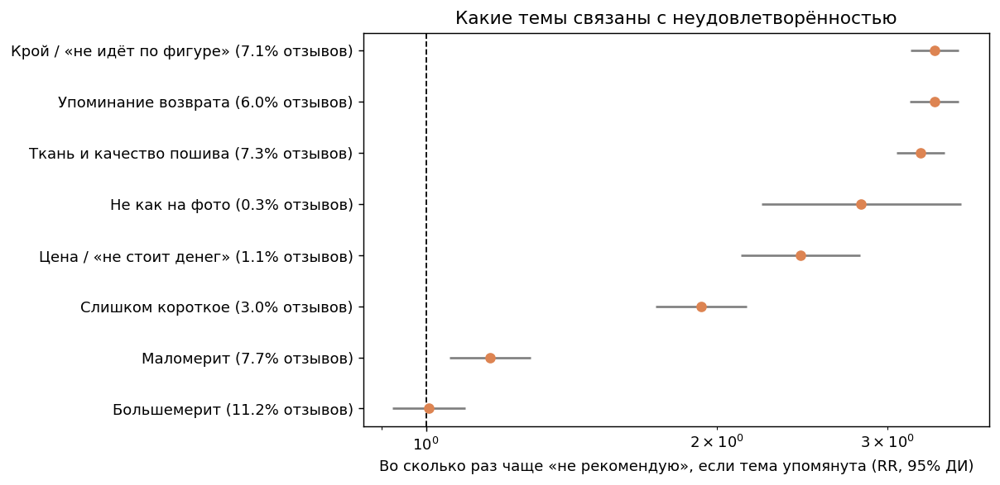
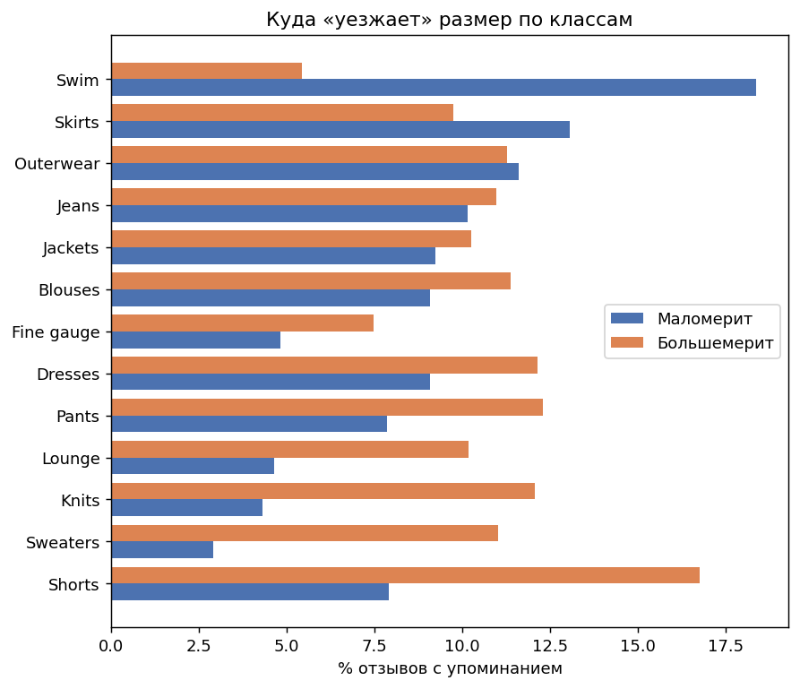
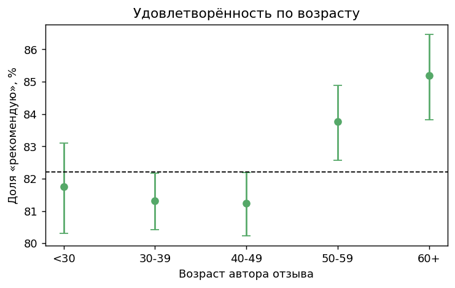
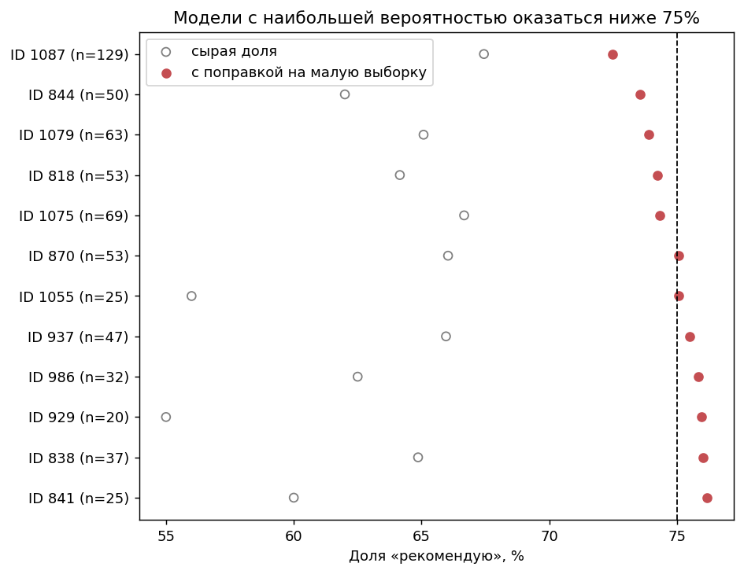

# Отчёт: что в отзывах мешает продуктам

## Данные

- Отзывов после очистки: 23,465 (удалено дублей: 21); моделей: 1,206
- Без текста: 825; без класса: 14; рейтинг 5, но «не рекомендую»: 25; рейтинг 1, но «рекомендую»: 16
- Общая доля «рекомендую»: 82.2%

## 1. Где клиенты менее довольны (классы изделий, n ≥ 100)

| Класс | Отзывов | Доля «рекомендую» | Разница с остальными | p (Холм) |
|---|---|---|---|---|
| Trend | 119 | 73.9% | -8.3 п.п. | 0.2725 |
| Sweaters | 1428 | 80.0% | -2.3 п.п. | 0.3792 |
| Swim | 350 | 80.6% | -1.7 п.п. | 1.0000 |
| Dresses | 6312 | 80.8% | -1.9 п.п. | 0.0103 |
| Blouses | 3093 | 81.0% | -1.4 п.п. | 0.6683 |
| Outerwear | 328 | 81.7% | -0.5 п.п. | 1.0000 |
| Knits | 4835 | 81.7% | -0.6 п.п. | 1.0000 |
| Pants | 1388 | 83.3% | +1.1 п.п. | 1.0000 |
| Fine gauge | 1099 | 83.7% | +1.6 п.п. | 1.0000 |
| Shorts | 317 | 83.9% | +1.7 п.п. | 1.0000 |
| Jackets | 704 | 84.5% | +2.4 п.п. | 1.0000 |
| Skirts | 945 | 84.6% | +2.4 п.п. | 0.6683 |
| Sleep | 228 | 85.5% | +3.3 п.п. | 1.0000 |
| Intimates | 154 | 85.7% | +3.5 п.п. | 1.0000 |
| Lounge | 691 | 86.0% | +3.9 п.п. | 0.1414 |
| Legwear | 165 | 86.1% | +3.9 п.п. | 1.0000 |
| Jeans | 1146 | 88.1% | +6.2 п.п. | <0.0001 |
| Layering | 146 | 88.4% | +6.2 п.п. | 0.6683 |

## 2. Какие темы связаны с «не рекомендую»

RR — во сколько раз чаще встречается «не рекомендую» среди отзывов, где тема упомянута, чем среди остальных. Это связь, а не причинно-следственный эффект.

| Тема | Доля отзывов | Среди «не рекомендую» | Среди «рекомендую» | RR [95% ДИ] | p (Холм) |
|---|---|---|---|---|---|
| Любая из «продуктовых» тем | 16.4% | 42.7% | 10.6% | 3.80 [3.61; 3.99] | <0.0001 |
| Крой / «не идёт по фигуре» | 7.1% | 20.5% | 4.2% | 3.36 [3.17; 3.55] | <0.0001 |
| Упоминание возврата | 6.0% | 17.7% | 3.5% | 3.35 [3.16; 3.56] | <0.0001 |
| Ткань и качество пошива | 7.3% | 20.3% | 4.4% | 3.24 [3.06; 3.44] | <0.0001 |
| Не как на фото | 0.3% | 0.8% | 0.2% | 2.82 [2.22; 3.57] | <0.0001 |
| Цена / «не стоит денег» | 1.1% | 2.8% | 0.8% | 2.44 [2.12; 2.81] | <0.0001 |
| Слишком короткое | 3.0% | 5.6% | 2.4% | 1.92 [1.73; 2.15] | <0.0001 |
| Маломерит | 7.7% | 8.9% | 7.4% | 1.16 [1.06; 1.28] | 0.0044 |
| Большемерит | 11.2% | 11.3% | 11.2% | 1.01 [0.92; 1.10] | 0.8776 |

## 3. Размер

См. график `sizing.png`: доли упоминаний «маломерит» и «большемерит» по классам.

## 4. Возраст

| Возраст | Отзывов | Доля «рекомендую» |
|---|---|---|
| <30 | 2931 | 81.7% |
| 30-39 | 7687 | 81.3% |
| 40-49 | 6124 | 81.2% |
| 50-59 | 3948 | 83.8% |
| 60+ | 2775 | 85.2% |

Хи-квадрат = 31.9, p = 2e-06, V Крамера = 0.037 (эффект малый).

## 5. Модели-кандидаты на разбор (n ≥ 15 отзывов, порог 75%)

Проверено моделей: 192. Различия между моделями превышают случайный шум (хи-квадрат 498 при df = 191, p = 3.3e-29). Моделей с вероятностью > 50% оказаться ниже порога: 5.

| ID модели | Класс | Отзывов | Сырая доля | С поправкой | P(< 75%) | Частые жалобы |
|---|---|---|---|---|---|---|
| 1087 | Dresses | 129 | 67% | 72% | 0.78 | Крой / «не идёт по фигуре», Ткань и качество пошива |
| 844 | Blouses | 50 | 62% | 74% | 0.63 | Крой / «не идёт по фигуре», Ткань и качество пошива |
| 1079 | Dresses | 63 | 65% | 74% | 0.6 | Ткань и качество пошива, Крой / «не идёт по фигуре» |
| 818 | Blouses | 53 | 64% | 74% | 0.56 | Ткань и качество пошива, Большемерит |
| 1075 | Dresses | 69 | 67% | 74% | 0.56 | Крой / «не идёт по фигуре», Ткань и качество пошива |
| 870 | Knits | 53 | 66% | 75% | 0.48 | Крой / «не идёт по фигуре», Маломерит |
| 1055 | Pants | 25 | 56% | 75% | 0.48 | Маломерит, Большемерит |
| 937 | Sweaters | 47 | 66% | 75% | 0.44 | Ткань и качество пошива, Крой / «не идёт по фигуре» |
| 986 | Jackets | 32 | 62% | 76% | 0.41 | Ткань и качество пошива |
| 929 | Sweaters | 20 | 55% | 76% | 0.4 | Слишком короткое, Крой / «не идёт по фигуре» |

## Графики

## Ограничения

- Данные одного магазина, женская одежда, анонимизированы: общие выводы о рынке делать нельзя.
- Темы определяются словарём ключевых слов с учётом отрицаний; это приближение, возможны ошибки в обе стороны.
- «Рекомендую / не рекомендую» — самооценка клиента; причины в тексте указаны не всегда.
- Нет данных о продажах, возвратах, цене и себестоимости, поэтому экономический эффект оценить нельзя.
